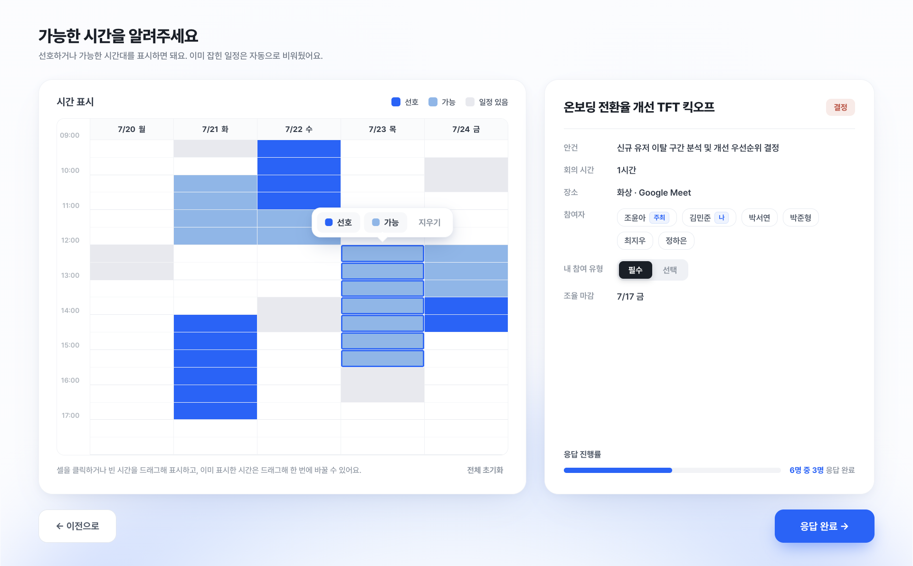
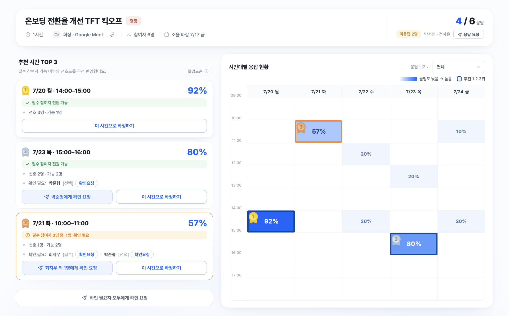

# Meeting Scheduling Recommendation Product

A meeting scheduling solution that recommends suitable meeting times based on participant availability, time preferences, and priority.

**Role:** Product Manager / Product Designer · **Type:** Solo Project · **Period:** Jul 2026  
**Output:** Functional Web Prototype  
**Live Demo:** [Try the Prototype →](https://tosschallenge-choyoona.netlify.app/)

---

### Participant View

Participants can mark time slots as preferred, available, or unavailable to express their scheduling preferences.

 

### Organizer View

Organizers can compare the top recommended meeting times based on participant priority and preferences, then confirm the best option.

